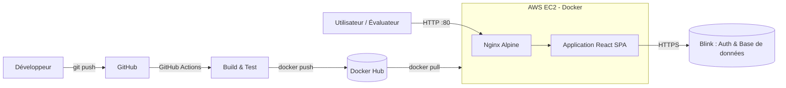

# 💼 SecureCashFlow - Terminal Bancaire & Gestion des Flux Financiers

[](https://github.com/Master-Mind-code/CashFlow/actions/workflows/docker-publish.yml)
[](https://hub.docker.com/r/DOCKERHUB_USERNAME/securecashflow)
[](https://react.dev/)
[](https://vitejs.dev/)
[](https://tailwindcss.com/)
[](https://nginx.org/)
[](https://aws.amazon.com/ec2/)

> **Projet académique** : *De l'application au déploiement dans le cloud*  
> Application web conteneurisée avec Docker et déployée sur une instance AWS EC2.

🔗 **Démo en ligne** : [`http://IP_PUBLIQUE_EC2`](http://IP_PUBLIQUE_EC2) &nbsp;|&nbsp; 🐳 **Docker Hub** : [`DOCKERHUB_USERNAME/securecashflow`](https://hub.docker.com/r/DOCKERHUB_USERNAME/securecashflow)

---

## 📸 Aperçu

| Tableau de bord | Dépôt | Retrait | Historique |
| :---: | :---: | :---: | :---: |
|  |  |  |  |

---

## 📌 1. Présentation du Projet

**SecureCashFlow** est une application web moderne simulant un terminal de caisse et de gestion des transactions financières sécurisées. Conçue pour répondre aux exigences des opérations en agence bancaire, elle garantit traçabilité, rapidité et conformité.

### 🌟 Fonctionnalités Principales

- 📊 **Tableau de bord interactif** : Vue d'ensemble des soldes, répartition des opérations et flux journaliers.
- 💵 **Module de Dépôt** : Alimentation de compte avec calcul dynamique des coupures et validation instantanée.
- 💳 **Module de Retrait Sécurisé** : Vérification des pièces d'identité, contrôle de provision et émission de reçus.
- 📜 **Historique & Audit** : Consultation, filtrage avancé des transactions passées et recherche multi-critères.
- 🔐 **Authentification** : Accès réservé au personnel autorisé via Blink Auth (session sécurisée, déconnexion).

> ℹ️ **SecureCashFlow est une simulation à but pédagogique** : aucune opération réelle n'est effectuée et la mention « Système certifié BIOTRANSAC » affichée dans l'interface est fictive.

### 🧪 Connexion et données de démonstration

- **Connexion** : bouton « Se connecter » (Blink Auth). Créez un compte avec votre e-mail ; le profil affiché est celui d'un **Caissier**.
- **Données de démo** : au premier lancement, deux comptes clients fictifs sont créés automatiquement :

| Numéro de compte | Titulaire | Solde initial | Pièce d'identité |
| :--- | :--- | ---: | :--- |
| `ACC-123-456-789` | Mamadou Diallo | 5 000 000 | `ID-882299` |
| `ACC-987-654-321` | Fatou Sow | 1 250 000 | `ID-110044` |

Ces comptes permettent de tester directement les modules **Versement** et **Retrait** (la vérification d'identité utilise le numéro de pièce ci-dessus).

---

## 🛠️ 2. Stack Technique & Architecture

- **Frontend** : React 19, TypeScript, Vite 7
- **UI / Design** : Tailwind CSS, Radix UI, Lucide Icons, Framer Motion
- **Backend as a Service** : Blink SDK (authentification et base de données hébergées par Blink, aucun serveur à gérer)
- **Routage** : React Router
- **Conteneurisation** : Docker (Multi-stage build : Node 20 Alpine -> Nginx Alpine)
- **Serveur Web** : Nginx (routage React SPA, compression Gzip, en-têtes de sécurité)
- **CI/CD** : GitHub Actions (build et publication automatique sur Docker Hub)
- **Hébergement Cloud** : Amazon Web Services (AWS EC2)

### Schéma d'architecture



### Arborescence

```
securecashflow/
├── .github/
│   └── workflows/
│       └── docker-publish.yml   # Pipeline CI/CD
├── docs/
│   ├── screenshots/             # Captures d'écran du README
│   └── presentation/            # Support de présentation
├── public/                      # Assets statiques publics
├── src/
│   ├── components/              # Composants UI réutilisables (Radix / Tailwind)
│   ├── domain/                  # Modèles de données & types métier
│   ├── hooks/                   # Custom Hooks React
│   ├── pages/                   # Pages (Dashboard, Deposit, Withdraw, History)
│   ├── App.tsx                  # Composant racine & Routage
│   └── main.tsx                 # Point d'entrée React
├── Dockerfile                   # Fichier Docker multi-étape commenté
├── nginx.conf                   # Configuration Nginx de production
├── .dockerignore                # Fichiers exclus du contexte Docker
└── README.md                    # Documentation complète
```

---

## 🚀 3. Guide de Démarrage en Local

### Prérequis
- [Node.js](https://nodejs.org/) (v20+)
- [npm](https://www.npmjs.com/) ou [bun](https://bun.sh/)
- [Docker](https://www.docker.com/) (optionnel pour l'exécution conteneurisée)

### Installation et Exécution

1. **Cloner le dépôt :**
   ```bash
   git clone https://github.com/Master-Mind-code/CashFlow.git
   cd CashFlow
   ```

2. **Installer les dépendances :**
   ```bash
   npm install
   ```

3. **Lancer le serveur de développement :**
   ```bash
   npm run dev
   ```
   L'application est accessible sur : `http://localhost:3000`

4. **Compiler pour la production (build local) :**
   ```bash
   npm run build
   ```

---

## 🐳 4. Conteneurisation avec Docker

Le projet utilise un `Dockerfile` multi-stage pour obtenir une image légère servie par Nginx.

### Construire l'image localement

```bash
docker build -t DOCKERHUB_USERNAME/securecashflow:v1 .
```

### Tester le conteneur en local

```bash
docker run -d -p 80:80 --name securecashflow-app DOCKERHUB_USERNAME/securecashflow:v1
```
Accédez ensuite à [http://localhost](http://localhost) depuis votre navigateur.

### Arrêter le conteneur

```bash
docker stop securecashflow-app
docker rm securecashflow-app
```

### Publier l'image sur Docker Hub

```bash
docker login
docker push DOCKERHUB_USERNAME/securecashflow:v1
```

> 💡 Cette étape est automatisée par la pipeline GitHub Actions (voir section 6).

---

## ☁️ 5. Déploiement sur AWS EC2

Conformément aux consignes, **l'image Docker n'est pas construite sur l'instance**, mais téléchargée depuis Docker Hub.

### 1. Préparation de l'instance EC2
- Lancer une instance EC2 (ex: *Amazon Linux 2023* ou *Ubuntu 24.04*, type `t2.micro` éligible Free Tier).
- Configurer le **Groupe de Sécurité (Security Group)** :
  - **SSH (Port 22)** : Accessible depuis votre IP uniquement (administration).
  - **HTTP (Port 80)** : Accessible depuis `0.0.0.0/0` (accès public des évaluateurs).

### 2. Connexion à l'instance
```bash
ssh -i "votre-cle.pem" ec2-user@<IP_publique_EC2>
```
*(Remplacez `ec2-user` par `ubuntu` si vous utilisez une AMI Ubuntu)*

### 3. Installation et démarrage de Docker sur EC2
```bash
# Pour Amazon Linux 2023 :
sudo dnf update -y
sudo dnf install -y docker
sudo systemctl enable --now docker
sudo usermod -aG docker $USER

# Se reconnecter ou recharger les permissions du groupe :
newgrp docker
```

*(Si Ubuntu : `sudo apt update && sudo apt install -y docker.io && sudo systemctl enable --now docker`)*

### 4. Téléchargement et lancement de l'application
```bash
docker pull DOCKERHUB_USERNAME/securecashflow:latest
docker run -d -p 80:80 --restart always --name securecashflow DOCKERHUB_USERNAME/securecashflow:latest
```

### 5. Mise à jour de l'application
```bash
docker pull DOCKERHUB_USERNAME/securecashflow:latest
docker stop securecashflow && docker rm securecashflow
docker run -d -p 80:80 --restart always --name securecashflow DOCKERHUB_USERNAME/securecashflow:latest
```

### 6. Vérification
- Vérifier que le conteneur tourne : `docker ps`
- Ouvrir dans votre navigateur : `http://<IP_publique_EC2>`

---

## ⚙️ 6. CI/CD avec GitHub Actions

À chaque `push` sur la branche `main`, le workflow `.github/workflows/docker-publish.yml` :

1. récupère le code et installe les dépendances ;
2. compile l'application (`npm run build`) pour détecter les erreurs ;
3. construit l'image Docker ;
4. la publie sur Docker Hub avec les tags `latest` et le hash du commit.

Secrets à définir dans **GitHub → Settings → Secrets and variables → Actions** :

| Secret | Contenu |
| :--- | :--- |
| `DOCKERHUB_USERNAME` | Nom d'utilisateur Docker Hub |
| `DOCKERHUB_TOKEN` | Jeton d'accès Docker Hub (Account Settings → Security) |

---

## 🧗 7. Difficultés rencontrées

> À compléter avec votre expérience réelle, par exemple :

- Configuration du routage SPA dans Nginx (erreur 404 au rafraîchissement d'une page).
- Ouverture du port 80 dans le Security Group AWS.
- Permissions Docker sur l'instance EC2 (`usermod -aG docker`).

---

## 🗺️ 8. Roadmap

- [ ] Backend API dédié (NestJS / Express) et base de données PostgreSQL, en remplacement de Blink
- [ ] Gestion des rôles (caissier, superviseur, admin) avec permissions par page
- [ ] Graphiques d'évolution des soldes (Recharts)
- [ ] Export PDF / CSV de l'historique et reçus imprimables
- [ ] Devise FCFA et calcul des coupures locales
- [ ] HTTPS avec Let's Encrypt
- [ ] Tests automatisés (Vitest, Playwright)
- [ ] Mode sombre et interface bilingue FR / EN

---

## 👥 9. Membres du Groupe & Rôles

| Membre | Rôle principal |
| :--- | :--- |
| **KONE ROKIA** | Conception & Développement Frontend (React/Vite) |
| **DJEDRO Touré Sééh Paterne-Junior** | Conteneurisation (Dockerfile, Nginx) & Tests locaux |
| **EBAH NIANGORAN JEAN-DOMINIque** | Déploiement Cloud AWS EC2 & Sécurité réseau |

---

## 📄 10. Livrables du Projet

1. **Dépôt GitHub public** : [`https://github.com/Master-Mind-code/CashFlow`](https://github.com/Master-Mind-code/CashFlow)
2. **Image Docker Hub** : `https://hub.docker.com/r/DOCKERHUB_USERNAME/securecashflow`
3. **URL publique de l'application** : `http://<IP_publique_EC2>`
4. **Support de présentation** : Disponible dans le dossier `/docs/presentation`

---

## 📜 Licence

Projet académique. Ajouter un fichier `LICENSE` (ex : MIT) à la racine si vous souhaitez autoriser la réutilisation.